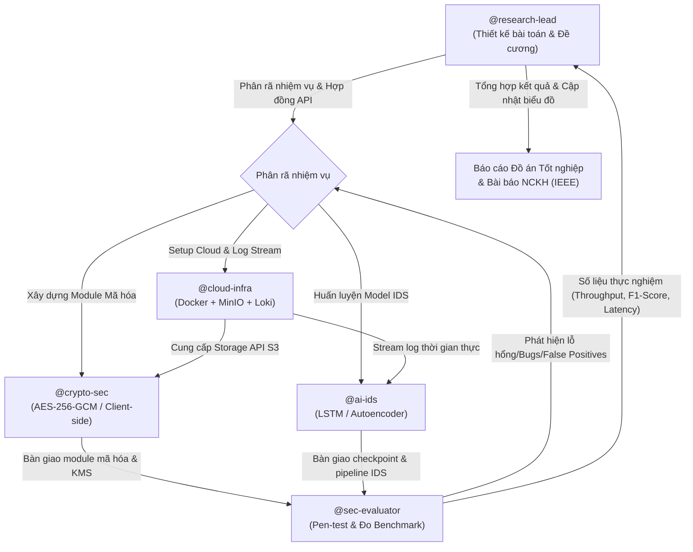

# CloudSec-Core: Multi-Agent System Architecture (.agents)

> **Đề tài**: Hệ thống bảo mật toàn diện cho đám mây riêng: Tích hợp mã hóa dữ liệu đầu cuối và giám sát an ninh thông minh dựa trên học sâu
> **Mã dự án**: `CloudSec-Core`
> **Mục tiêu kép**: Hoàn thiện Đồ án tốt nghiệp Kỹ sư An toàn thông tin & Công bố bài báo Nghiên cứu Khoa học (NCKH).

---

## 1. Giới thiệu Kiến trúc Multi-Agent

Hệ sinh thái `.agents` được thiết kế theo mô hình **Phòng Lab Nghiên cứu & Phát triển ATTT Tự động hóa**, phân định rạch ròi trách nhiệm của 5 Agent chuyên trách tương ứng với các cấu phần kỹ thuật và các chương trong luận văn/paper:

```
.agents/
├── AGENTS.md               # Hiến chương và quy ước hoạt động chung của toàn hệ thống
├── agents/                 # Chân dung, trách nhiệm và phạm vi của từng Agent chuyên trách
│   ├── research-lead.md    # Lead Researcher & Project Architect
│   ├── cloud-infra.md      # Cloud & Container Security Engineer
│   ├── crypto-sec.md       # Cryptography & End-to-End Security Engineer (NCKH Focus)
│   ├── ai-ids.md           # Deep Learning IDS Engineer (Thesis Focus)
│   └── sec-evaluator.md    # Pen-tester, Stress-tester & Academic Benchmark Analyst
├── rules/                  # Quy chuẩn mật mã, tiêu chuẩn NCKH, hardening & bàn giao
│   ├── crypto-standards.md # Chuẩn mã hóa, quản lý IV/Nonce, độ dài khóa, zeroization
│   ├── ai-pipeline-rules.md# Tiêu chuẩn tiền xử lý, chống data leakage, metric IEEE
│   ├── cloud-hardening.md  # Docker rootless, cô lập network MinIO, cgroups limits
│   ├── handoff-rules.md    # Giao thức bàn giao giữa các Agent và hợp đồng dữ liệu
│   └── git-user-mapping.md # Ánh xạ danh tính Git author theo từng vai trò
├── tasks/                  # Bảng quản lý tiến độ thực nghiệm (File-based Task Board)
│   ├── cloud-infra/        # active / done
│   ├── crypto-sec/         # active / done
│   ├── ai-ids/             # active / done
│   ├── sec-evaluator/      # active / done
│   ├── thesis-drafting/    # active / done
│   └── vulnerabilities/    # Bug, vulnerability & false-positive log
├── skills/                 # Thư viện kỹ năng chuyên sâu (Domain-specific Skills)
│   ├── minio-storage-api/          # Thao tác S3 SDK boto3, stream chunking, policy
│   ├── cryptographic-benchmarking/ # Đo latency (μs), throughput (MB/s), CPU/RAM
│   ├── deep-learning-ids/          # Kiến trúc PyTorch LSTM/Autoencoder, dynamic threshold
│   ├── attack-simulation/          # Giả lập DDoS, Brute-force, Data tampering, Locust
│   └── academic-latex-reporting/   # Xuất bảng LaTeX IEEE, vẽ biểu đồ Seaborn/Matplotlib
└── workflows/              # Quy trình tự động hóa thực nghiệm một chạm
    ├── run-benchmark.md    # Pipeline đo đạc mã hóa và sinh biểu đồ so sánh
    ├── train-eval-ids.md   # Pipeline huấn luyện mô hình IDS và sinh Confusion Matrix
    └── thesis-sync.md      # Pipeline đồng bộ số liệu thực nghiệm vào bản thảo luận văn
```

---

## 2. Luồng phối hợp giữa các Agent (Collaboration Workflow)



---

## 3. Quy tắc vận hành chung cho Pair-Programming & Multi-Agent

1. **Tuân thủ phân quyền Agent**: Khi tương tác dưới vai trò nào, Agent chỉ chỉnh sửa mã nguồn và tasks thuộc thư mục được phân quyền tương ứng.
2. **Hợp đồng bàn giao (Handoff Contracts)**: Mọi module khi bàn giao sang Agent khác phải có unit tests, script demo và file cấu hình mẫu.
3. **Tính tái lập khoa học (Scientific Reproducibility)**: Tất cả thực nghiệm phải cố định `random_seed`, ghi log đầy đủ thông số phần cứng (CPU model, RAM, OS, Python version, Docker cgroups) và lưu kết quả thô (`.csv`, `.json`).
4. **Không hardcode bí mật**: Khóa mã hóa, token S3, JWT secret tuyệt đối không commit vào git. Luôn nạp qua biến môi trường hoặc KMS cục bộ.
