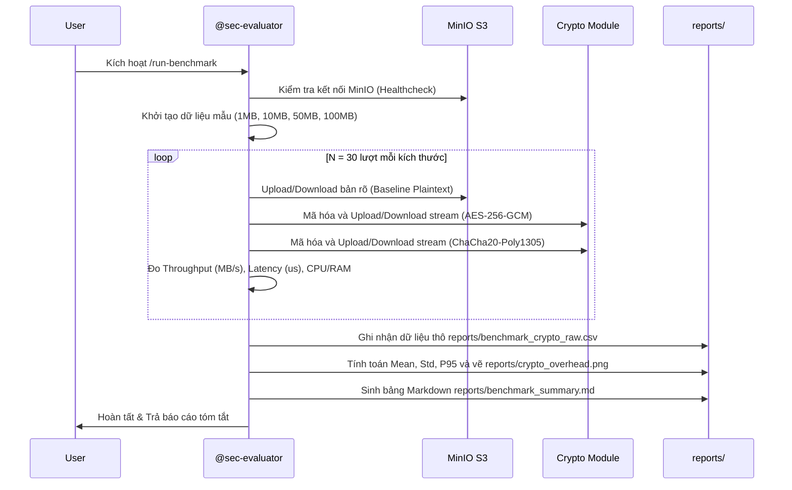

# Workflow: Run Cryptographic & Storage Benchmark (/run-benchmark)

> **Mã quy trình**: `WF-01-BENCHMARK`  
> **Lệnh kích hoạt nhanh**: `/run-benchmark`  
> **Agent thực thi**: `@sec-evaluator` (hỗ trợ bởi `@crypto-sec` và `@cloud-infra`)  
> **Mục tiêu**: Tự động đo đạc hiệu năng mã hóa đầu cuối trên MinIO S3 giữa 2 chế độ (Có mã hóa AES-256-GCM / ChaCha20 vs Không mã hóa) và xuất biểu đồ so sánh vào `reports/crypto_overhead.png`.

---

## 1. Các bước thực thi tự động (Automated Pipeline Steps)



---

## 2. Lệnh thực thi chi tiết

Khi người dùng gõ `/run-benchmark` hoặc yêu cầu đo đạc hiệu năng, Agent thực hiện các thao tác:

1. **Kiểm tra trạng thái hạ tầng**:
   ```powershell
   python scripts/infra/healthcheck.py
   ```
2. **Kích hoạt kịch bản đo đạc tự động**:
   ```powershell
   python benchmarks/run_crypto_benchmark.py --iterations 30 --sizes 1,10,50,100 --output reports/benchmark_crypto_raw.csv
   ```
3. **Sinh biểu đồ và báo cáo tóm tắt**:
   ```powershell
   python benchmarks/generate_plots.py --input reports/benchmark_crypto_raw.csv --output-dir reports/
   ```

---

## 3. Điều kiện nghiệm thu (Acceptance Criteria)

- [ ] File `reports/benchmark_crypto_raw.csv` chứa tối thiểu 30 mẫu cho mỗi kích thước tệp.
- [ ] File `reports/crypto_overhead.png` được tạo với độ phân giải cao $\ge 300\text{ DPI}$.
- [ ] Bảng tóm tắt `reports/benchmark_summary.md` thể hiện rõ:
  - Throughput trung bình của Plaintext vs AES-GCM vs ChaCha20.
  - Tỷ lệ suy giảm thông lượng (Throughput Overhead %).
  - Độ trễ bổ sung (Latency delta).
- [ ] Task trong `.agents/tasks/sec-evaluator/` được cập nhật sang thư mục `done/`.
