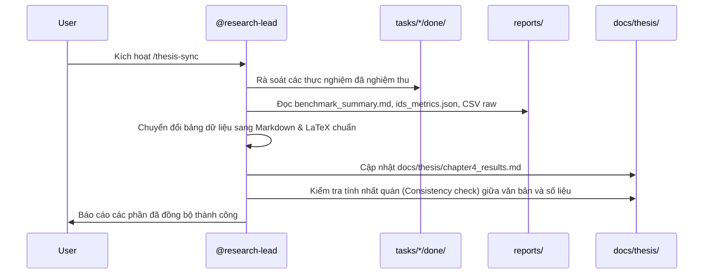

# Workflow: Synchronize Research Metrics with Thesis Draft (/thesis-sync)

> **Mã quy trình**: `WF-03-THESIS-SYNC`  
> **Lệnh kích hoạt nhanh**: `/thesis-sync`  
> **Agent thực thi**: `@research-lead` (tiếp nhận dữ liệu từ `@sec-evaluator` và `@ai-ids`)  
> **Mục tiêu**: Tự động quét toàn bộ số liệu thực nghiệm mới nhất từ `reports/` và các task đã hoàn thành trong `.agents/tasks/*/done/`, sau đó đồng bộ, cập nhật trực tiếp vào các bảng dữ liệu, biểu đồ và văn bản trong bản thảo luận văn (`docs/thesis/chapter4_results.md`).

---

## 1. Các bước thực thi tự động (Automated Pipeline Steps)



---

## 2. Lệnh thực thi chi tiết

Khi người dùng gõ `/thesis-sync` hoặc yêu cầu đồng bộ số liệu vào đồ án:

1. **Quét dữ liệu thực nghiệm**:
   ```powershell
   python scripts/thesis/sync_metrics.py --reports-dir reports/ --target-doc docs/thesis/chapter4_results.md
   ```
2. **Kiểm tra tính toàn vẹn và xung đột số liệu**:
   - So khớp mọi con số xuất hiện trong đoạn văn phân tích với bảng số liệu đính kèm.
   - Cảnh báo nếu số liệu qua các lần benchmark có độ lệch chuẩn quá lớn ($> 15\%$).

---

## 3. Điều kiện nghiệm thu (Acceptance Criteria)

- [ ] File `docs/thesis/chapter4_results.md` được cập nhật chính xác với timestamp mới nhất.
- [ ] Bảng so sánh Throughput và Latency phản ánh đúng kết quả từ `reports/benchmark_summary.md`.
- [ ] Bảng đánh giá mô hình Deep Learning (Accuracy, Precision, Recall, F1, FPR, ROC-AUC) khớp tuyệt đối với `reports/ids_metrics.json`.
- [ ] Các đường dẫn hình ảnh biểu đồ (`reports/crypto_overhead.png`, `reports/ids_confusion_matrix.png`) hiển thị chính xác trong bản thảo.
