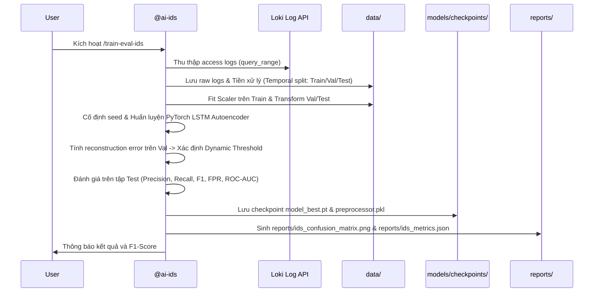

# Workflow: Train & Evaluate Deep Learning IDS (/train-eval-ids)

> **Mã quy trình**: `WF-02-AI-IDS`  
> **Lệnh kích hoạt nhanh**: `/train-eval-ids`  
> **Agent thực thi**: `@ai-ids` (phối hợp với `@cloud-infra` và `@sec-evaluator`)  
> **Mục tiêu**: Trích xuất log MinIO/mạng từ Loki hoặc kho dữ liệu thô, tiền xử lý chuỗi thời gian, huấn luyện mô hình PyTorch (LSTM Autoencoder), xác định ngưỡng động, đánh giá Precision, Recall, F1-Score và xuất ma trận nhầm lẫn chuẩn IEEE.

---

## 1. Các bước thực thi tự động (Automated Pipeline Steps)



---

## 2. Lệnh thực thi chi tiết

Khi người dùng gõ `/train-eval-ids` hoặc yêu cầu train lại mô hình phát hiện xâm nhập:

1. **Trích xuất và chuẩn bị dữ liệu**:
   ```powershell
   python src/ai_ids/extract_logs.py --source loki --output data/raw_logs.csv
   python src/ai_ids/preprocess.py --input data/raw_logs.csv --output-dir data/processed/ --window-size 20
   ```
2. **Huấn luyện mô hình PyTorch**:
   ```powershell
   python src/ai_ids/train.py --data-dir data/processed/ --epochs 50 --batch-size 32 --lr 0.001 --save-dir models/checkpoints/
   ```
3. **Đánh giá và xuất biểu đồ IEEE**:
   ```powershell
   python src/ai_ids/evaluate.py --checkpoint models/checkpoints/ids_lstm_autoencoder_best.pt --test-data data/processed/test.pt --output-dir reports/
   ```

---

## 3. Điều kiện nghiệm thu (Acceptance Criteria)

- [ ] Checkpoint mô hình `models/checkpoints/ids_lstm_autoencoder_best.pt` được tạo thành công.
- [ ] Không có cảnh báo Data Leakage (Scaler chỉ được fit trên tập Train).
- [ ] Báo cáo `reports/ids_metrics.json` ghi nhận:
  - $\text{Recall} \ge 95\%$ trên các kịch bản tấn công.
  - $\text{False Positive Rate (FPR)} \le 1.5\%$.
  - $\text{F1-Score} \ge 0.94$.
- [ ] Đồ thị ma trận nhầm lẫn `reports/ids_confusion_matrix.png` được tạo và đạt chuẩn IEEE.
