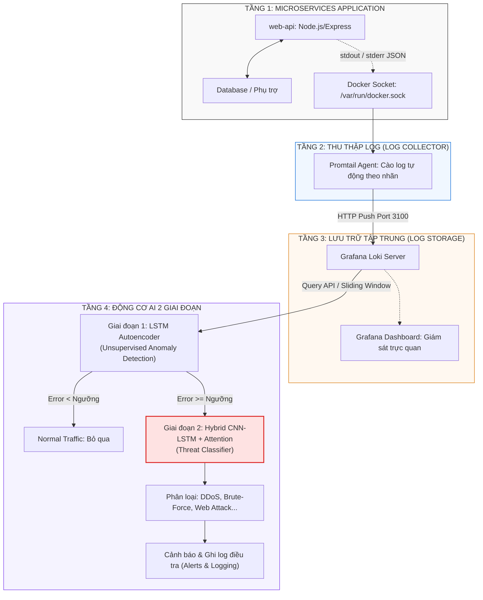

Dưới đây là nội dung hoàn chỉnh của file README.md theo chuẩn tài liệu dự án kỹ
thuật (Technical Project Documentation). Bạn chỉ cần tạo file tên README.md ngay
tại thư mục gốc của dự án (~/ids-microservices/README.md) và dán toàn bộ nội
dung sau vào.

File này giải thích toàn diện từ bài toán, kiến trúc hệ thống 4 tầng, pipeline
AI 2 giai đoạn, luồng hoạt động đến hướng dẫn cài đặt và kiểm tra.

# 🛡️ Two-Stage AI-Driven Intrusion Detection System (IDS) for Local Microservices/Cloud Infrastructure

> **Tên đề tài tiếng Anh:** *A Two-Stage Intelligent Intrusion Detection System for Microservices: Combining Unsupervised Anomaly Detection and Supervised Hybrid Deep Learning for Automated Threat Classification*  
> **Môn học:** Đồ án 3 (Chuyên ngành An toàn thông tin / Khoa học máy tính)  
> **Môi trường triển khai:** Docker / Docker Compose trên nền tảng Linux (Ubuntu Server) thông qua VS Code CLI.

---

## 📌 1. Giới thiệu tổng quan

Trong môi trường Microservices đóng gói container (Docker/Cloud), việc giám sát an ninh bằng phương pháp dựa trên luật (Rule-based) hoặc chỉ phân tích gói tin mạng tĩnh truyền thống bộc lộ nhiều điểm yếu:
- Tỉ lệ báo động giả (False Positive) cao do lưu lượng nội bộ thay đổi liên tục.
- Không phát hiện được các mối đe dọa mới xuất hiện (Zero-day attacks).
- Tiêu tốn nhiều tài nguyên hệ thống nếu mô hình Deep Learning quá nặng.

Dự án này đề xuất một **Kiến trúc IDS 2 giai đoạn (Two-Stage Pipeline)** kết hợp giữa **Học không giám sát (Unsupervised)** và **Học sâu lai có giám sát (Supervised Hybrid Deep Learning)**, tích hợp trực tiếp vào hạ tầng giám sát log thời gian thực với **Promtail + Grafana Loki**.

---

## 🏗️ 2. Sơ đồ kiến trúc tổng thể (System Architecture)

Hệ thống được tổ chức thành 4 phân tầng độc lập theo luồng dữ liệu (Data Pipeline) từ lúc sinh log cho tới khi đưa ra cảnh báo:




⚙️ 3. Chi tiết chức năng từng phân tầng

🔹 Tầng 1: Microservices Application Tier

  - Thành phần: Ứng dụng mẫu đa tầng (web-api-service) chạy Node.js/Express.
  - Nhiệm vụ: Mô phỏng ứng dụng thực tế cung cấp các endpoint công khai và bảo
    mật (/, /api/login). Toàn bộ hoạt động được ghi nhận có cấu trúc (JSON
    Format) qua stdout.

🔹 Tầng 2: Log Collection Tier (Promtail)

  - Thành phần: Container promtail-agent.
  - Nhiệm vụ: Mount trực tiếp socket /var/run/docker.sock trên máy host để giám
    sát vòng đời các container. Tự động gắn nhãn metadata (tên container,
    stream, image) và gửi dữ liệu về Loki theo thời gian thực mà không làm giảm
    hiệu năng của ứng dụng chính.

🔹 Tầng 3: Centralized Storage Tier (Grafana Loki)

  - Thành phần: Container loki-server.
  - Nhiệm vụ: Khác với Elasticsearch lưu toàn bộ nội dung văn bản làm tốn nhiều
    RAM, Loki chỉ lập chỉ mục (index) các nhãn metadata, giúp tối ưu bộ nhớ cục
    bộ (phù hợp máy cá nhân/server nhỏ). Loki cung cấp REST API cho phép tầng AI
    truy vấn dữ liệu dạng sliding window bằng ngôn ngữ LogQL.

🔹 Tầng 4: Two-Stage Deep Learning Pipeline Tier

Điểm cải tiến cốt lõi của đề tài nhằm vượt trội so với các nghiên cứu một mô
hình truyền thống:

1.  Stage 1 (LSTM Autoencoder - Anomaly Detector):
      - Huấn luyện hoàn toàn trên dữ liệu hành vi bình thường (Normal Baseline).
      - Mô hình học cách giải mã và tái tạo lại chuỗi log thông thường.
      - Khi có bất thường (kể cả dạng tấn công chưa từng gặp - Zero-day), sai số
        tái tạo (Reconstruction Error) vượt ngưỡng động cho phép, kích hoạt
        Stage 2.
2.  Stage 2 (Hybrid CNN-LSTM with Attention - Threat Classifier):
      - Chỉ được kích hoạt khi Stage 1 gắn cờ bất thường, giúp tiết kiệm tối đa
        chu kỳ CPU/GPU.
      - Lớp 1D-CNN quét các pattern độc hại trong câu log.
      - Lớp Bi-LSTM nắm bắt sự phụ thuộc thời gian giữa các request.
      - Cơ chế Attention tập trung trọng số vào các sự kiện then chốt (như dồn
        dập mã 401 hoặc tràn mã 500).
      - Đầu ra phân loại chính xác hình thức tấn công (Brute-force, DDoS, Scan)
        và lưu vào kho điều tra (Investigation Alert Logs).

📁 4. Cấu trúc thư mục dự án
```
ids-microservices/
├── README.md                 # Tài liệu thuyết minh kiến trúc (File này)
├── docker-compose.yml        # Điều phối toàn bộ các container dịch vụ
├── promtail-config.yaml      # File cấu hình cào log Docker của Promtail
├── backend_app/              # Mã nguồn ứng dụng mẫu
│   ├── Dockerfile            # Đóng gói image cho backend
│   └── server.js             # API Express sinh log
└── ai_engine/                # (Sẽ triển khai ở Giai đoạn 3)
    ├── train_autoencoder.py  # Huấn luyện mô hình Stage 1
    ├── train_classifier.py   # Huấn luyện mô hình Stage 2
    └── inference_pipeline.py # Script lắng nghe Loki và chạy mô hình 2 giai đoạn
```
🚀 5. Hướng dẫn khởi chạy và vận hành nhanh

1. Khởi động hạ tầng

Tại terminal của thư mục dự án, chạy lệnh:

docker compose up -d --build

Kiểm tra trạng thái các container:

docker compose ps

(Đảm bảo cả web-api-service, loki-server, và promtail-agent đều đang ở trạng
thái running).

2. Sinh log kiểm tra kết nối

Gửi request bình thường:

curl http://localhost:3000/

Gửi request kích hoạt log cảnh báo (đăng nhập thất bại):

curl -X POST http://localhost:3000/api/login \
     -H "Content-Type: application/json" \
     -d '{"username":"attacker","password":"badpassword"}'

3. Kiểm tra log từ Loki API

Truy vấn trực tiếp từ Loki xem log đã được thu thập hay chưa:

curl -G -s "http://localhost:3100/loki/api/v1/query_range" \
  --data-urlencode 'query={container="web-api-service"}' | grep -o 'LOGIN_FAILED'


